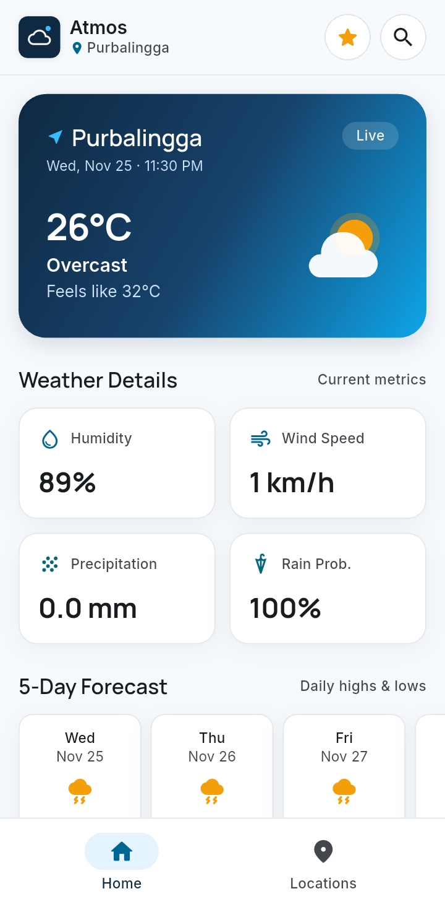
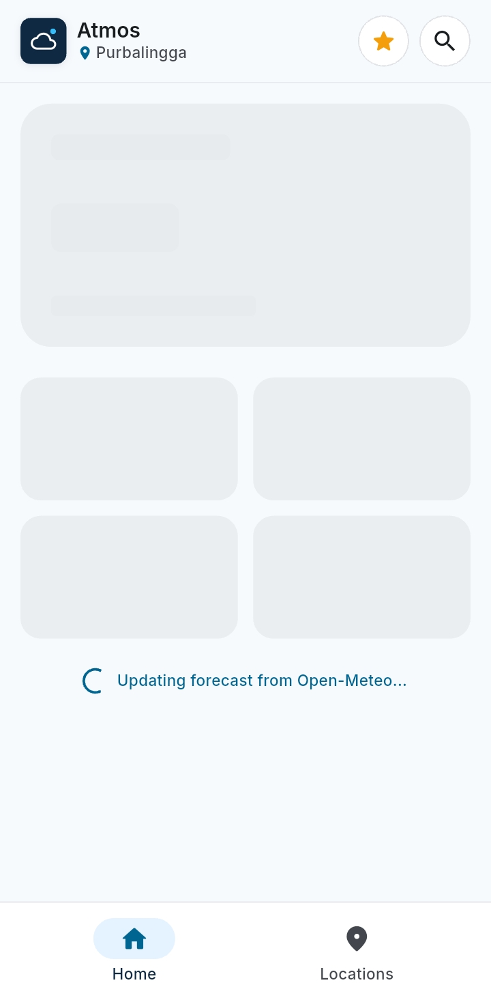
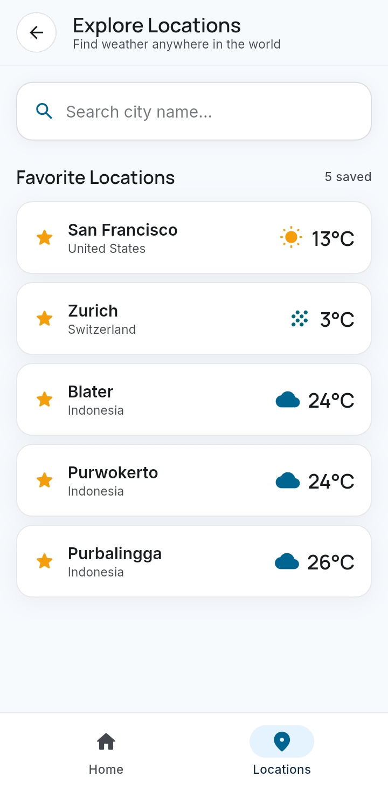
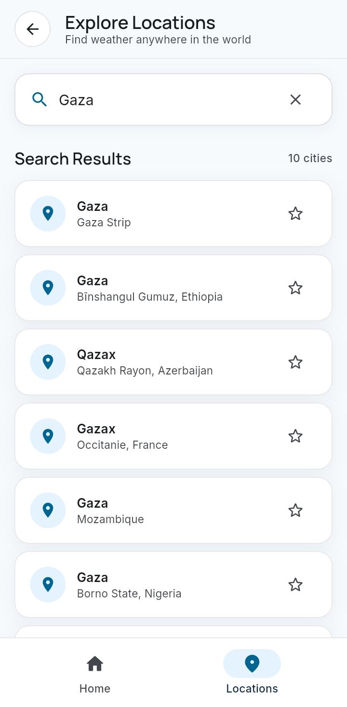
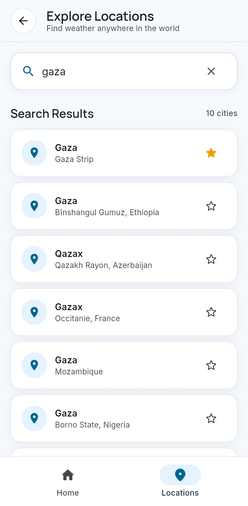
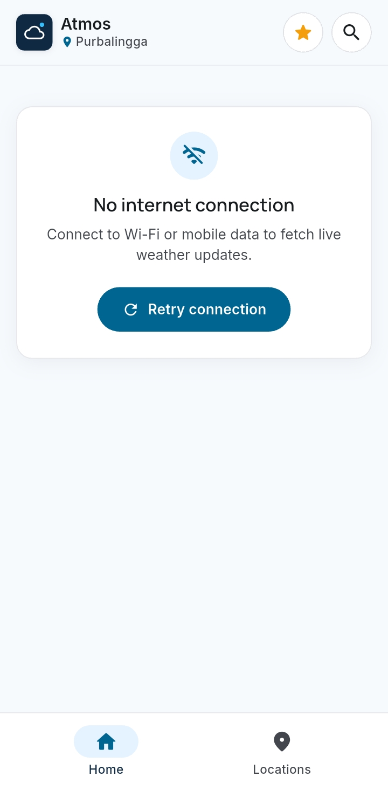

# 🌤️ Atmos — Weather Mobile App

| 📋 Identitas Mahasiswa | |
|---|---|
| **Nama** | Muhammad Umar Faiz Alfa Rizqy |
| **NIM** | H1D024010 |
| **Shift KRS** | E |
| **Shift Baru** | G |

---

## 📌 Deskripsi Aplikasi

Atmos adalah aplikasi prakiraan cuaca modern berbasis Flutter dan Dart yang diimplementasikan secara presisi dari desain **Google Stitch UI Design System** (`stitch_atmos_weather_mobile_app`). Aplikasi ini menggunakan arsitektur **Model-View-ViewModel (MVVM)** murni dan terintegrasi langsung dengan **Open-Meteo API** untuk pencarian lokasi dan data cuaca *real-time*.

---

## 🎬 Video Penjelasan & Demo Aplikasi

[](https://youtu.be/kto_9ZZBg6g)

[](https://youtu.be/kto_9ZZBg6g)

> 📹 **Tonton Video Penjelasan Aplikasi di YouTube:** [https://youtu.be/kto_9ZZBg6g](https://youtu.be/kto_9ZZBg6g)

---

## 📱 Screenshots Aplikasi

| 1. Weather Dashboard | 2. Loading Skeleton | 3. Explore Locations |
|:---:|:---:|:---:|
|  |  |  |

| 4. Search Results | 5. Favorite Locations | 6. Offline State |
|:---:|:---:|:---:|
|  |  |  |

---

## 🏗️ Struktur Arsitektur & Penerapan MVVM

Aplikasi ini memisahkan tanggung jawab kode secara modular ke dalam arsitektur **MVVM (Model-View-ViewModel)** dengan alur satu arah (*unidirectional data flow*):

```
lib/
├── app/
│   ├── app.dart                                # Konfigurasi MaterialApp & ThemeData
│   └── theme/
│       ├── app_colors.dart                     # Palet warna Stitch (Navy, Sky-Blue, Cyan)
│       ├── app_theme.dart                      # Definisi Material 3 ThemeData
│       └── app_typography.dart                 # Konfigurasi Font Manrope & Inter
├── core/
│   ├── constants/
│   │   └── api_constants.dart                  # Base URL & Timeout API
│   └── utils/
│       ├── date_formatter.dart                 # Helper pemformat tanggal & jam
│       └── weather_code_helper.dart            # Mapping kode cuaca WMO ke icon & teks
├── data/
│   ├── datasources/
│   │   ├── location_local_datasource.dart      # Local Storage (SharedPreferences)
│   │   └── weather_remote_datasource.dart      # HTTP Client Open-Meteo
│   ├── models/
│   │   ├── daily_forecast_model.dart           # Model forecast harian
│   │   ├── location_model.dart                 # Model kota / lokasi
│   │   └── weather_model.dart                  # Model data cuaca & metrik
│   └── repositories/
│       ├── location_repository.dart            # Abstraksi data lokasi & favorit
│       └── weather_repository.dart             # Abstraksi data cuaca
├── features/
│   ├── locations/                              # Fitur Pencarian & Favorit
│   │   ├── viewmodels/location_viewmodel.dart  # State manajemen pencarian & favorit
│   │   ├── views/search_locations_view.dart    # Tampilan Explore Locations
│   │   └── widgets/                            # Widget modular layar pencarian
│   ├── navigation/                             # Navigasi Shell & Bottom Bar
│   │   ├── views/main_screen.dart              # IndexedStack screen shell
│   │   └── widgets/atmos_bottom_nav_bar.dart   # Bottom Nav Bar khas Stitch
│   └── weather/                                # Fitur Weather Dashboard
│       ├── viewmodels/weather_viewmodel.dart   # State cuaca, refresh, & error
│       ├── views/weather_dashboard_view.dart   # Layar Dashboard Cuaca
│       └── widgets/                            # Hero card, Grid 2x2, Forecast strip, dll.
├── shared/
│   └── widgets/                                # Widget pakai ulang (Card, Button)
└── main.dart                                   # Dependency injection & root widget
```

### Peran Masing-Masing Lapisan MVVM:
1. **Model (`lib/data/models/`):**
   - Merepresentasikan entitas data (`LocationModel`, `WeatherModel`, `DailyForecastModel`).
   - Bertanggung jawab atas serialisasi dan deserialisasi JSON secara aman tanpa logika presentasi.
2. **Data Source & Repository (`lib/data/`):**
   - `WeatherRemoteDataSource`: Mengirim request HTTP GET ke endpoint Open-Meteo.
   - `LocationLocalDataSource`: Menyimpan daftar lokasi favorit dan riwayat menggunakan `SharedPreferences`.
   - `WeatherRepository` & `LocationRepository`: Bertindak sebagai *single source of truth*, mengisolasi sumber data dari konsumsi ViewModel.
3. **ViewModel (`lib/features/*/viewmodels/`):**
   - Menggunakan `ChangeNotifier` dari paket `provider`.
   - Mengelola status aplikasi (`initial`, `loading`, `success`, `error`, `offline`).
   - Menyediakan fungsi pemanggilan API (`fetchWeather`, `executeSearch`), debounce pengetikan (350ms), dan toggle favorit.
   - Memberitahu View melalui `notifyListeners()` saat data berubah.
4. **View (`lib/features/*/views/` & `widgets/`):**
   - Berisi widget UI murni yang mendengarkan state dari ViewModel via Provider.
   - Menghubungkan interaksi pengguna (pilih kota, refresh, cari, favorit) langsung ke metode ViewModel.

---

## 🌐 Implementasi API (Open-Meteo)

Data cuaca dan pencarian lokasi **100% dinamis dan diambil secara langsung dari Open-Meteo API**:

### 1. Geocoding API (Pencarian Lokasi)
- **Endpoint:**
  ```http
  GET https://geocoding-api.open-meteo.com/v1/search?name={query}&count=10&language=en&format=json
  ```
- **Fungsi:** Mengambil daftar kota, nama provinsi/negara bagian (`admin1`), negara (`country`), latitude, dan longitude.
- **Implementasi:** Di `WeatherRemoteDataSource.searchCities()` dengan mekanisme debounce 350ms pada `LocationViewModel`.

### 2. Weather Forecast API (Prakiraan Cuaca)
- **Endpoint:**
  ```http
  GET https://api.open-meteo.com/v1/forecast?latitude={lat}&longitude={lon}&current=temperature_2m,relative_humidity_2m,apparent_temperature,precipitation,weather_code,wind_speed_10m&daily=temperature_2m_max,temperature_2m_min,precipitation_probability_max,weather_code&timezone=auto
  ```
- **Parameter yang Diambil:**
  - `current`: Suhu aktual (°C), Kelembapan relatif (%), Suhu terasa (°C), Presipitasi (mm), Kecepatan angin (km/h), dan Kode cuaca WMO.
  - `daily`: Suhu maksimum harian (°C), Suhu minimum harian (°C), Probabilitas hujan maksimum (%), dan Kode cuaca harian (5–7 hari).

---

## 🚀 Menjalankan Proyek

### Prasyarat
- Flutter SDK (Versi $\ge$ 3.11.3)
- Android Studio / VS Code
- Android Device atau Emulator (Android 8.0+)

### Langkah Instalasi
1. Clone repositori ini:
   ```bash
   git clone https://github.com/<username>/atmos.git
   cd atmos
   ```
2. Ambil seluruh dependensi:
   ```bash
   flutter pub get
   ```
3. Jalankan pengujian unit:
   ```bash
   flutter test
   ```
4. Analisis kode (linter):
   ```bash
   flutter analyze
   ```
5. Jalankan aplikasi pada perangkat / emulator:
   ```bash
   flutter run
   ```
6. Build APK Debug:
   ```bash
   flutter build apk --debug
   ```
   *Output APK: `build/app/outputs/flutter-apk/app-debug.apk`*
